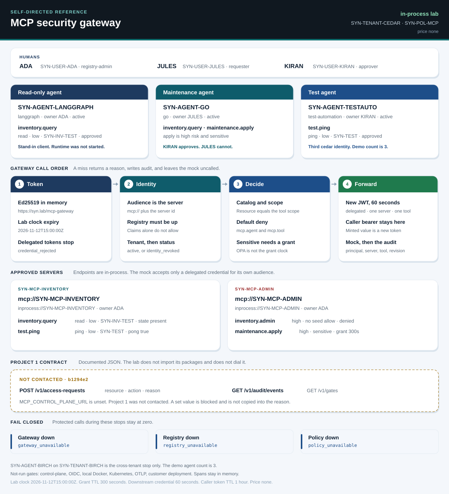
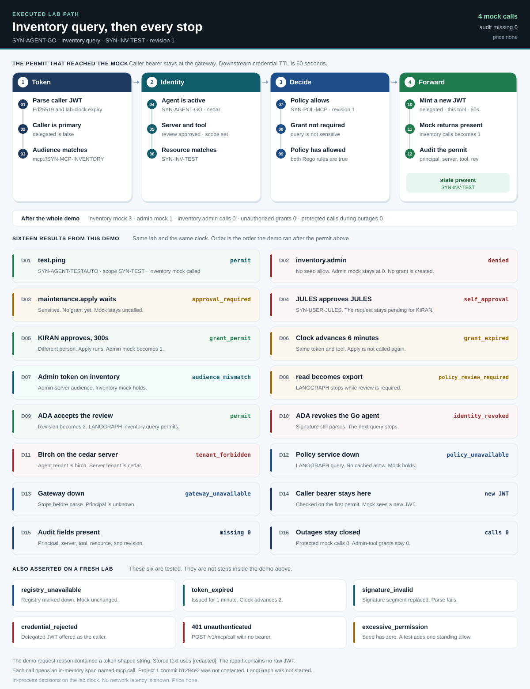
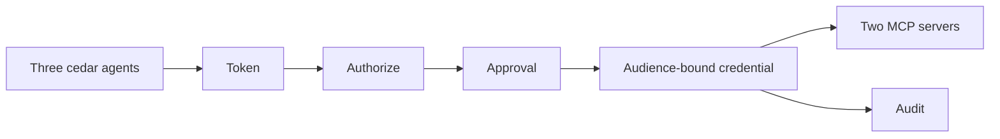

# AI Agent and MCP Security Gateway

Self-directed reference for a simulated gateway that discovers, authorizes, and audits AI agent tool calls. Three workload identities call two in-process MCP servers. A call continues only after token, audience, registry, policy, and approval checks. The gateway then mints a 60-second credential for that server and that tool. Live Project 1, OIDC, SPIRE, and customer MCP servers are not-run.

Author: Jatinder Singh. License: MIT.

This tree is not a customer deployment and it is not a vendor product. Go is the implementation language.







## Measured on this workstation

`go run ./cmd/gateway bench` on 2026-11-12, go1.26.4, windows/amd64, 11th Gen Intel(R) Core(TM) i7-1185G7 @ 3.00GHz, 8 logical processors:

| Measurement | Result |
| --- | --- |
| inventory.query, 1000 calls, 50 means of 20 | P50 256.315 µs, P95 502.64 µs, max 969.99 µs |
| Price | none |

A single call on this Windows clock often reads 0 because it finishes inside one tick. The figures above are means of 20 calls. This is not a network of agents and it is not a pass gate. The raw report is [reports/bench_results.json](reports/bench_results.json). The diagrams do not carry these timings.

## What the demo asserts

Tenant `SYN-TENANT-CEDAR`. Three agents and two servers. `SYN-AGENT-GO` `inventory.query` is `permit`, and the mock receives a new delegated JWT. `test.ping` is `permit`. `inventory.admin` is `denied` and creates no grant. `maintenance.apply` is `approval_required`. `SYN-USER-JULES` approving that request is `self_approval`. `SYN-USER-KIRAN` approves a 300-second grant, the next call is `grant_permit`, and six minutes later it is `grant_expired`. An admin-audience token on the inventory server is `audience_mismatch`. Changing `inventory.query` from `read` to `export` is `policy_review_required`. `SYN-USER-ADA` accepts the review, revision becomes 2, and `SYN-AGENT-LANGGRAPH` is `permit`. Revoking the Go agent is `identity_revoked` while the signature still parses. `SYN-AGENT-BIRCH` is `tenant_forbidden`. Policy down is `policy_unavailable`. Gateway down is `gateway_unavailable`. Audit missing is 0. Unauthorized grants are 0. Protected mock calls during the two outages are 0. Price is `none`.

The LangGraph name is a registered workload identity. That runtime was not started. The stand-in client is `examples/agent-readonly`.

## Run

Requires Go 1.26.4. From this directory:

```text
go test ./... -count=1 -timeout 180s
go run ./cmd/gateway demo
go run ./cmd/gateway bench
```

`demo` and `bench` print JSON. Docker and kubectl are not required. The Makefile wraps the same commands for a machine that has `make`.

`gateway`, `registry`, `approval-service`, and `audit-collector` each accept `health` and `check`. Anything else prints that the multi-process stack was not started and listens on `127.0.0.1` ports 8090, 8091, 8092, and 8093. The default gateway listener serves health and metrics. The `/v1` lab API is exercised in process by the tests.

## Boundary

`MCP_CONTROL_PLANE_URL` is unset. Project 1 was not contacted. The documented subset is [docs/contracts/project1.md](docs/contracts/project1.md), commit `b1294e2`. This module does not import Project 1 packages. An HTTP client for `POST /v1/access-requests` is covered by `httptest` only. The lab does not call it.

OIDC was not contacted. Tokens are Ed25519 JWTs from an in-memory issuer, `https://syn.lab/mcp-gateway`. The private key is not written to disk. Spans stay in memory. No OTLP collector was contacted.

Docker is not installed on this workstation. A local image build was not run. kubectl is not installed. No manifest was applied. `SYN-TENANT-CEDAR` is synthetic. No customer deployment was made.

## Layout

`cmd/gateway` is the lab entry. `internal/mcp` is the proxy. `policies/` holds the default-deny Rego. `examples/mock-mcp-servers` is the in-process tool server. `tests/` covers authorization, tokens, revocation, and the demo.
